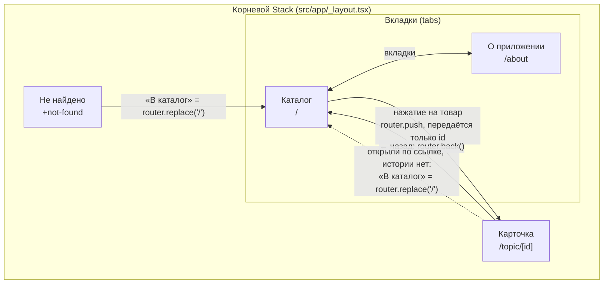
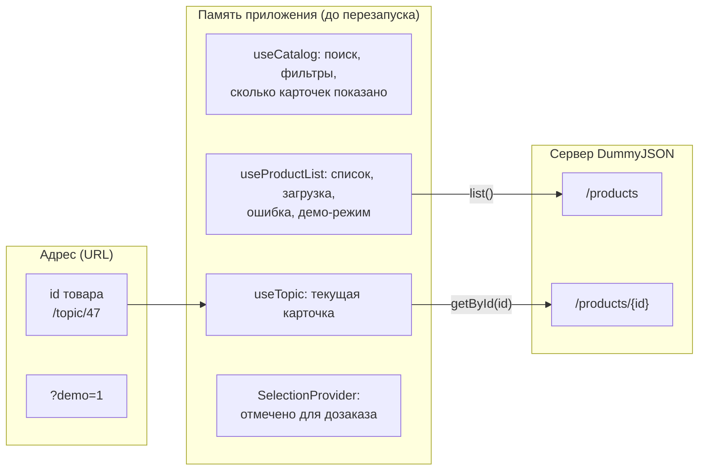
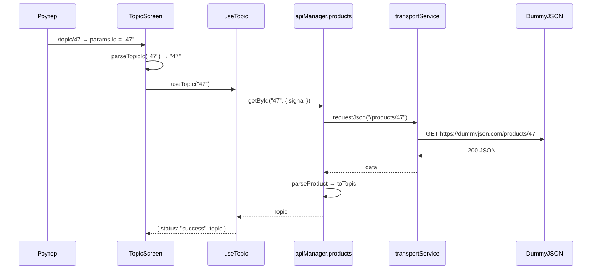

# Навигация

## Карта экранов

| Адрес | Файл | Экран | Как уйти |
|---|---|---|---|
| `/` | `src/app/(tabs)/index.tsx` | Каталог | вкладка «О приложении», системная «Назад» закрывает приложение |
| `/about` | `src/app/(tabs)/about.tsx` | О приложении | вкладка «Каталог» или системная «Назад» (возвращает на первую вкладку) |
| `/topic/1` | `src/app/topic/[id].tsx` | Карточка товара | стрелка в шапке или системная «Назад». Если открыли по ссылке и истории нет — кнопка «В каталог» в шапке |
| `/topic/1?demo=1` | тот же | Карточка из демо-данных, без запроса к серверу | так же |
| `/topic/abc` | тот же | «Неверный номер товара», запроса нет | кнопка «В каталог» |
| любой другой | `src/app/+not-found.tsx` | «Страница не найдена» | кнопка «В каталог» |

Карточка открывается в корневом Stack поверх вкладок, поэтому вкладки на ней не видны, а каталог под ней остаётся смонтированным.

## Где хранятся данные

| Что | Где хранится | Кто владелец | Что происходит |
|---|---|---|---|
| id карточки | в адресе `/topic/[id]` | роутер | через адрес передаётся только id, а не объект товара: карточка загружает данные сама, поэтому работает и по прямой ссылке |
| признак демо-режима | в адресе, `?demo=1` | роутер | карточка берёт товар из тестовых данных |
| поиск, категория, «только заканчивающиеся», число показанных карточек | state в `useCatalog` | экран каталога | при переходе в карточку и назад сохраняется, потому что каталог остаётся смонтированным под карточкой |
| место прокрутки списка | внутри `FlatList` | экран каталога | так же сохраняется |
| список товаров, загрузка, ошибка | state в `useProductList` | экран каталога | загружается один раз при открытии каталога |
| данные открытой карточки | state в `useTopic` | экран карточки | при закрытии карточки удаляются, при следующем открытии загружаются заново |
| отмеченные для дозаказа | `SelectionProvider` над Stack | всё приложение | общие для каталога и карточки |
| всё перечисленное | — | — | при перезапуске приложения память очищается, постоянного хранения нет |

Почему отметки вынесены в Provider: каталог и карточка — разные экраны. Если в каждом вызвать hook с `useState`, у каждого будет свой отдельный state, и отметка из карточки не появится в каталоге.

## Путь запроса карточки

Если `parseTopicId` не пропустил id (например `abc`), `useTopic` получает `undefined` и запрос не делает. Если сервер ответил 404, `useTopic` возвращает `not_found`, остальные ошибки — `error` с кнопкой «Повторить». При смене id или закрытии карточки старый запрос отменяется (`abort()` в cleanup), а его поздний ответ отбрасывается (`isActual()`).

## Прямая ссылка

| Где | Ссылка |
|---|---|
| Expo Go на телефоне | `exp://АДРЕС:8081/--/topic/1`, где `АДРЕС` — адрес из строки `Metro waiting on exp://...` в терминале |
| Expo Web | `http://localhost:8081/topic/1` |
| собранное приложение (development build) | `ostatok://topic/1`, схема `ostatok` задана в `app.json` |

## Протокол проверок

Платформа: <!-- впиши: Android, модель телефона, Expo Go --> 

| Сценарий | Шаги | Ожидаемый результат | Фактический результат |
|---|---|---|---|
| Поиск → карточка → назад | Ввести `e`, включить «Только заканчивающиеся», прокрутить, открыть товар, нажать стрелку назад | Поиск, фильтр и позиция списка сохранены | «Найдено: 22 из 194», запрос `e`, фильтр включён, прокрутка на том же месте |
| Ссылка после чистого старта | Закрыть приложение, открыть `/topic/1` | Карточка загружается без посещения списка | Карточка «Essence Mascara Lash Princess», единственный запрос — `/products/:id`, в шапке «В каталог» |
| «В каталог» без истории | На карточке, открытой по ссылке, нажать «В каталог» | Переход в каталог | Открылся каталог, загрузился список |
| `/unknown` | Открыть неизвестный адрес | +not-found и переход в каталог | «Страница не найдена», кнопка «В каталог» |
| `/topic/abc` | Открыть адрес с нечисловым id | Сообщение о неверном id, запроса к API нет | «Неверный номер товара», новых `http.start` нет. То же для `/topic/0` |
| Верный id, mock 404 | Тестовый режим «HTTP 404», открыть товар | Запись не найдена, есть выход в каталог | «Товар не найден», «В каталог» возвращает назад к списку |
| Нет сети и повтор | Режим «Нет сети», открыть товар, выключить режим на карточке, «Повторить» | Ошибка, затем успешная загрузка | «Нет связи с сервером», после «Повторить» карточка загрузилась |
| Смена id при медленном ответе | Режим «Медленно 3 с», на карточке сменить id 4 → 5 через секунду | Поздний ответ id 4 не заменяет карточку | Запрос id 4 отменён (`outcome: cancel`), «Red Lipstick» не появлялся, на экране id 5 |
| Вкладки и системный возврат | Каталог → «О приложении» → «Каталог»; карточка → «Назад» | Нет тупиков и дубликатов | Состояние каталога сохраняется при переключении вкладок, «Назад» с карточки ведёт в каталог |
| Быстрые повторные нажатия | Дважды быстро нажать на товар | Открывается одна карточка | Один переход и один запрос карточки, одна запись в истории |
| Демо-режим | Ошибка списка → «Показать демо-данные» → открыть товар | Карточка из демо-данных без запроса | Метка «Демо-данные», остаток из тестовых данных, запроса нет |
| Отметка в карточке | Открыть товар, «+ В дозаказ», вернуться | Отметка видна в каталоге | «Отмечено для дозаказа: 1», карточка в списке отмечена |
| Нет регрессии Sprint 4 | Пройти `docs/network-checks.md` | Всё как в Sprint 4 | Список, ошибки, повтор, демо и логи работают |

Автоматические проверки: `npm run typecheck`, `npm run lint`, `npm test` (22 теста, из них 3 на разбор id из адреса — `topicId.test.ts`).
